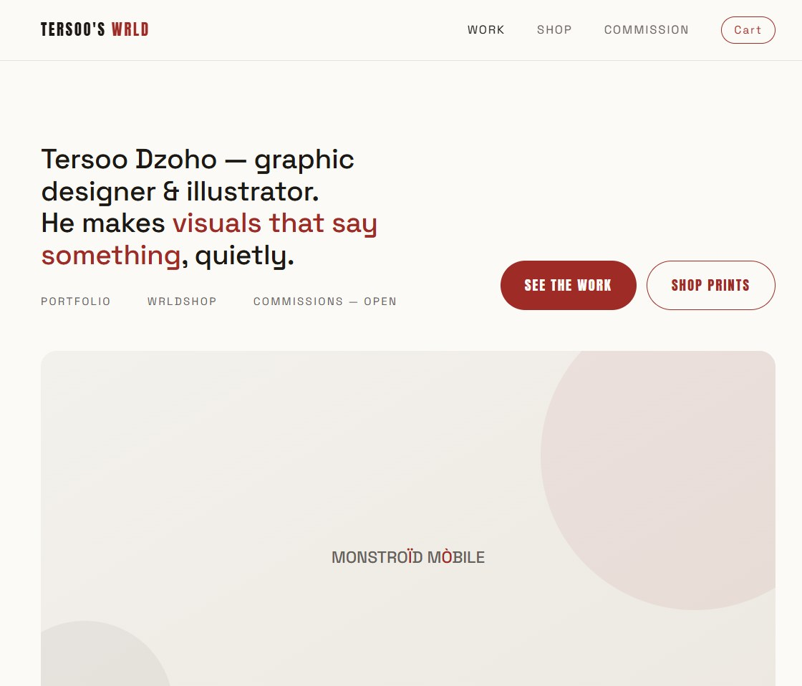
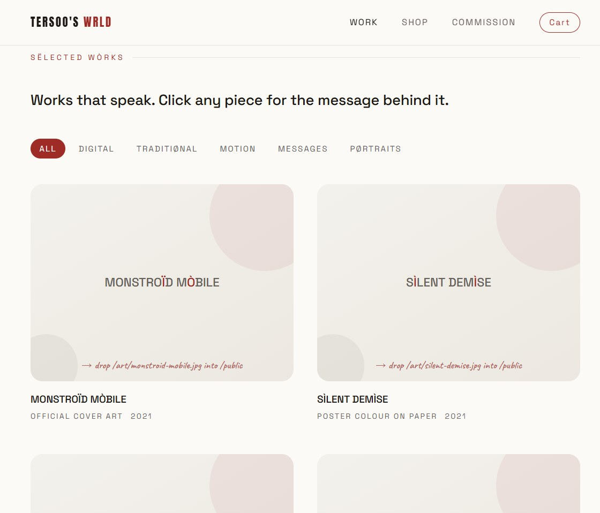
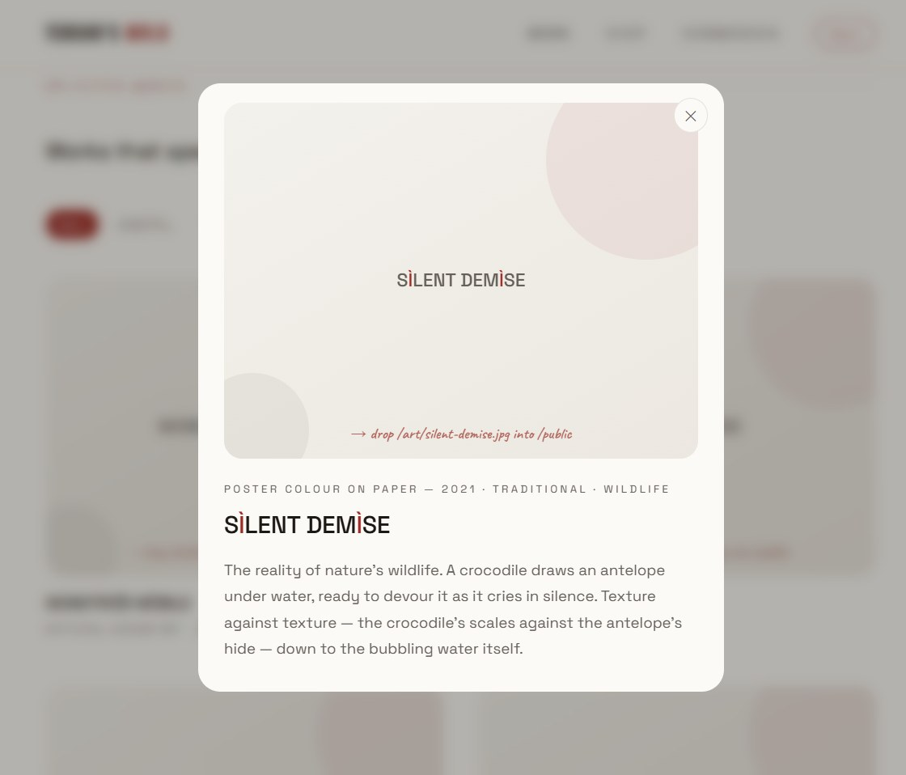
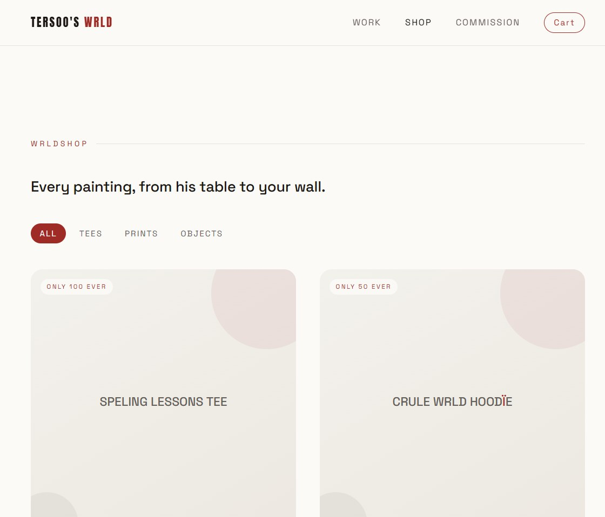
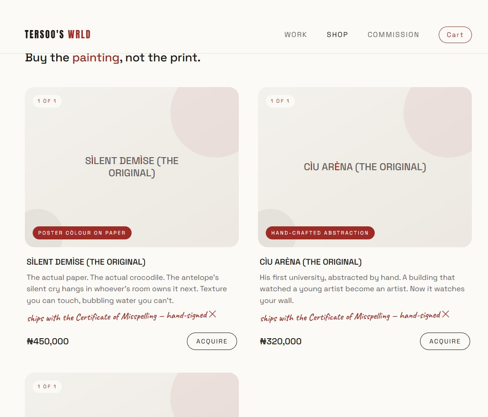
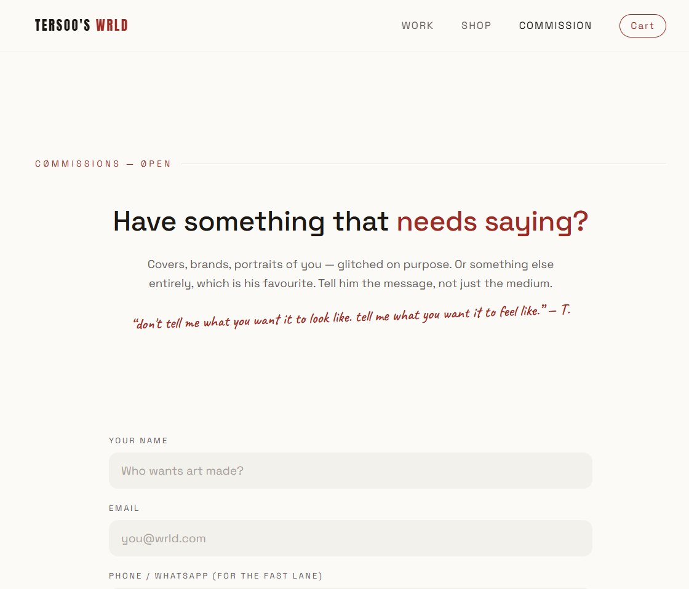

# TERSOO'S WRLD — the quiet one (v2)

A minimal portfolio + art store for **Tersoo Timothy Dzoho** — graphic
designer & illustrator. Every misspelling is on purpose. That's the signature.

> **Live for real, forever:**
> - **this repo (v2) → <https://tersoos-wrld-v2.vercel.app>**
> - v1, the loud "before" (proof-of-concept repo) → <https://tersoos-wrld-v1.vercel.app> · <https://github.com/BemFeese/tersoos-wrld-v1>

---

## The idea

The brief was one sentence long: *let the art speak for itself.* So v2
subtracts. Paper-white pages, oxblood `#9E2B25` as the only colour voice,
18px-rounded frames on every artwork, and nothing — no cursor theatrics, no
grain, no marquees — standing between the visitor and a piece.

| | v1 — avant-garde (`before`) | **v2 — the quiet one (`after`, this repo)** |
|---|---|---|
| Colour | ink black + signal orange, acid yellow | **paper white `#fbfaf7` + oxblood `#9E2B25`** |
| Frames | straight, hard corners | **18px rounded** on every artwork & card |
| Chrome | paint cursor, splatter canvas, film grain, marquees | thin sticky nav + soft fades — nothing else |
| Bundle | 3.1 kB | **1.7 kB** — quiet is literally lighter |

Same engine both times: Next.js 15 App Router, WRLDSHOP with limited
editions, one-of-one originals, commission intake, Paystack-ready checkout,
flat-file ledgers, and a key-gated artist back office at `/admin`.

---

## Screenshots — the quiet one, live

### The gate
One sentence, two quiet buttons, and a featured work already on the wall:



### The gallery wall
Eleven works with room to breathe. Filters stay whisper-quiet; clicking any
piece opens *the message behind it* — every artwork carries a story, because
an artist's work should explain itself in the artist's words:



The story view — the frame rounds to meet the copy:



### WRLDSHOP
Editorial calm: image, name, edition note, price. Nothing shouts. Edition
scarcity stamps (`ONLY 100 EVER`) keep the shop honest without noise:



The **1/1 gallery** — originals go here with a small oxblood plaque and
hand-written certificate line. Sold pieces self-stamp; there are no restocks
of a painting:



### Commissions
A single quiet form. Briefs land in the back office with a reference number:



---

## What it does

**Portfolio**
- 11 selected works, each with a story told in the artist's own words
- Speech filters (digital / traditional / motion / messages / portraits)
- Featured-work landing that puts the art above the fold immediately

**WRLDSHOP (real commerce, no mocks)**
1. Buyer fills the checkout modal → `POST /api/checkout`
2. The server **re-prices every line from the data file** — client prices
   are advisory only, so cart tampering buys nothing
3. Order is stamped into the ledger with a `WRLD-XXXX` reference
4. Payment: with `PAYSTACK_SECRET_KEY` set, real Paystack initialize +
   redirect and `/paid?ref=…` verifies server-to-server before showing PAID;
   without it, the shop falls back to a manual-confirmation flow with the
   reference number. Amounts are NGN (kobo) throughout.
5. Editions enforce scarcity in plain data: `stock: 0` → **SØLD** card

**1/1 originals** — a separate catalogue for the actual paintings ("buy the
painting, not the print"), each described by medium, ships with the
Certificate of Misspelling.

**Commissions** — briefs (name, contact, type, budget band, timeline, ≥20
characters of intent) with `CM-XXXX` references.

**Back office** — `/admin` shows orders, commission briefs and the
subscriber list. Gated by an `ADMIN_KEY` env secret. *(The key is configured
 privately in `.env.local` / host env vars; it is never published here.)*

**Newsletter** — a one-field subscription, counted in the back office.

---

## How Tersoo manages it (no code, ever)

1. **Add an artwork** → drop the file into `public/art/` with the exact
   filename already listed in `lib/data.js` (e.g. `/art/crule-wrld.jpg`).
   It appears instantly. Until then, a quiet paper stand-in holds the slot.
2. **Change everything else** — works, stories, products, prices, stock,
   edition notes, socials — it all lives in **`lib/data.js`**, plainly
   commented at the top.
3. **Sell an original** → the 1/1 list is under `originals` in `lib/data.js`.

## Stack

- **Next.js 15 (App Router) + React 19** — 13 routes, static-first
- **Flat-file JSON ledgers** in `data/` with an in-memory fallback so the
  same engine behaves identically on a Node server and on serverless hosts
- **Paystack** initialize/verify — server-side only, secret never in the
  browser; NGN (kobo) math guarded by server re-pricing
- **Fonts:** Space Grotesk (voice), Anton (wordmark only), Caveat
  (the artist's whispers)

## Run it locally

```bash
npm install
npm run dev        # → http://localhost:3000
```

Production build (**stop the dev server first** — building while it runs
corrupts its `.next` cache):

```bash
npm run build
npm start
```

Environment: copy `.env.example` → `.env.local`
(`ADMIN_KEY`, optional `PAYSTACK_SECRET_KEY`, fallback payment link,
contact link). None of these are committed, by design.

## Deployment notes

Runs on any Node host; deploys cleanly on Vercel serverless (the ledger
falls back to instance memory automatically). When order volume becomes
real, move `lib/orderStore.js` to a hosted database — its seven functions
are the whole surface area to swap.

---

## Status — the finished design

This is the **finished and agreed-upon design** — the outcome of the
`v1 → v2` build study, approved by the client. It is deliberately
different from [version 1](https://github.com/BemFeese/tersoos-wrld-v1),
the avant-garde proof of concept that preceded it: where v1 made the site
itself an artwork (paint cursor, splatter layers, marquees,
museum-at-night), v2 steps back to paper white, oxblood and rounded frames
so the art speaks for itself.
